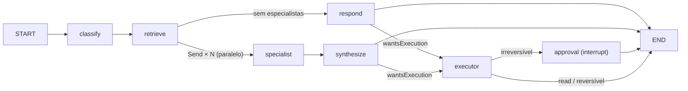

# Arquitetura — CARINA (versão TypeScript, fase 1)

Este documento descreve o que está construído em `apps/`, `packages/` e `docker-compose.yml`. A
visão geral e a demo estão no [README](../README.md). As decisões, os defeitos do Python corrigidos
e as garantias com os testes que as provam estão em
[DECISOES-E-GARANTIAS.md](DECISOES-E-GARANTIAS.md). O
desenho original e as razões das decisões estão no
[spec da migração](superpowers/specs/2026-11-11-migracao-typescript-design.md). A versão Python
antiga está em `legacy/python`.

## 1. Processos e implantação

| Processo | Entrada | O que roda |
| --- | --- | --- |
| `api` | `apps/api/src/main.ts` → `createApiApp()` | REST (`/api/*`), WebSocket do chat (`/ws/chat`, mesma porta), `InboxBroadcast`. Com `WORKERS_ENABLED !== "false"`, também os workers (útil em desenvolvimento, um processo só) |
| `worker` | `apps/api/src/main.worker.ts` → `createWorkerContext()` | `SyncWorker` (grupo `sync` em `jobs`), `ResumeWorker` (grupo `resumers` em `jobs`), `ImportWorker` (grupo `imports` em `jobs`), `ReconciliationJob` (timer de 60 s com lock Redis), `ImportCleanupJob` (timer de 5 min com lock Redis) e `MonitorJob` (timer de 10 min, só no pregão, com lock Redis; ver [§15](#15-monitor-de-carteira-monitor)) e `AopJob` (agenda a cada `AOP_TICK_MS` com lock Redis e consumidor do grupo `aops` em `jobs`; ver [§18](#18-procedimentos-agendados-aops)). Força `WORKERS_ENABLED=true` e não abre porta |
| `migrate` | `prisma migrate deploy` (imagem `migrate`) | Migrações 0001–0009, escritas à mão, como `carina_migrator`. Roda uma vez |
| `seed` | `node dist/seed/seed.js` | Tenant `demo` (id fixo), duas chaves e três clientes sintéticos já sincronizados. Idempotente |
| `web` | nginx (`apps/web/nginx.conf`) | SPA do Vite, proxy de `/api` e `/ws` para `api:3000`, cabeçalhos de segurança e CSP |

O bootstrap fica num lugar só ([`bootstrap.ts`](../apps/api/src/bootstrap.ts)): `main.ts` e os
testes de boot ([`health.e2e.spec.ts`](../apps/api/test/health/health.e2e.spec.ts),
[`full-flow.e2e.spec.ts`](../apps/api/test/flow/full-flow.e2e.spec.ts)) usam a mesma
`configureHttpApp`: body parser de 5 MB, adaptador `ws`, prefixo `/api`, CORS restrito ao
`WEB_ORIGIN` e `ProblemDetailsFilter` global.

Uma falha de boot sai no stderr com a stack e a cadeia de `cause`
([`boot-error.ts`](../apps/api/src/core/errors/boot-error.ts)). O `Env` é validado com Zod na
subida. Com `NODE_ENV=production`, `LLM_MODE` é obrigatória.

**Réplicas.** Várias instâncias de `api` são seguras: os limites ficam no Redis, cada processo
HTTP tem o seu tail de `inbox.events` e os turnos de chat são serializados por thread com lock
Redis. Várias instâncias de `worker` também: consumer groups, dedup por `eventId`, lock por
cliente no Sync, lock por tick na reconciliação e execução única garantida no banco. A demo usa
uma de cada.

## 2. Monorepo e fronteiras

```
packages/shared   Zod + tipos: ChatRequest/ChatEvent/ChatResponse, ApprovalView, UsageSummary,
                  AuditEventView, NormalizedPosition/Transaction, StreamEvent, Problem, Money.
                  Sem dependência de Node; o web importa direto do fonte.
apps/api/src/core config (Env + models.yaml), context (TenantContext), database (PrismaService,
                  TenantPrismaService), redis (cache, streams, locks), logging (pino), errors
                  (DomainError → RFC 9457), http (body parser, adaptador ws)
apps/api/src/modules
  tenancy         hash de chaves, ApiKeyGuard, escopos, LiveKeyService, clientes
  limits          RateLimitGuard (janela deslizante) e QuotaService (cota mensal), em Lua
  llm             ModelFactory por papel, withFallbacks, limitador por provedor, embeddings, mock
  knowledge       ingestão de documentos (chunks, entidades, relações, embeddings) e busca híbrida
  agents          navigator, insight, predictor, risk, strategist, tax, researcher,
                  assessor_liaison, executor (prompt + schema + limites)
  orchestrator    grafo LangGraph, checkpointer Postgres, ResumeWorker
  inbox           risco, solicitações, decisão com trava, executores simulados, execução única,
                  reconciliação
  billing         preço por tipo de trabalho, fee sobre valor executado, resumo do mês
  watchtower      flags de compliance e trilha de auditoria append-only (pergunta com PII
                  mascarada e truncada; resposta só como digest)
  chat            POST /chat, ticket do WS, ChatGateway, InboxBroadcast
  data-ingestion  API de ingestão em lote, gerador sintético, categorizer, SyncWorker
  imports         upload de OFX/CSV/XLSX B3, parsers, ImportWorker e ImportCleanupJob
  market          cotações, histórico e indicadores macro (brapi.dev + BCB SGS ou mock), cache no
                  Redis, rotas `/api/market/*` e `MarketService.priceFor` (preço de servidor)
  evaluation      benchmark SEAL BR: dataset estático, correção determinística e rotas
                  `/api/eval/*`
  builder         estratégias declarativas (Postgres, RLS), backtest determinístico e rotas
                  `/api/builder/*`
  aops            procedimentos agendados (Postgres, RLS): compilador, runner, AopJob e rotas
                  `/api/aops/*`
  health          /health e /ready (single-flight + cache curto)
```

As regras de fronteira são verificadas assim:

- Só `core/database` e `modules/tenancy` importam o `PrismaService` (sem RLS). É uma regra de
  ESLint, fixada por
  [`prisma-import-restriction.spec.ts`](../apps/api/src/core/database/prisma-import-restriction.spec.ts).
  O resto usa `TenantPrismaService`.
- Só `llm` fala com provedores de modelo. Só `agents` e `orchestrator` usam LangGraph.
- O SQL do conhecimento (pgvector, `WITH RECURSIVE`) é fixo e parametrizado, e fica num único
  `KnowledgeRepository`. **O LLM nunca gera SQL.**

## 3. Ciclo de vida de uma requisição

1. **`ApiKeyGuard`** (global). Aceita `Authorization: Bearer sk-live-…` ou `X-API-Key`. Confere o
   formato antes de ir ao banco e chama `resolve_api_key(sha256)`, uma função `SECURITY DEFINER`
   com `search_path = public, pg_temp`. Chave revogada ou tenant suspenso → 401. `@Public()` só em
   `/health` e `/ready`.
2. **Escopos.** Toda rota não pública declara `@RequireScopes` (todos) ou `@RequireAnyScope` (um
   deles): `chat`, `inbox:decide`, `data:write`, `market:read`, `eval:run`, `builder:run`, `aops:manage` e `admin`.
3. **`RateLimitGuard`.** Janela deslizante de 60 s por tenant (ZSET + Lua), com `Retry-After`.
   Falha fechado se o Redis cair.
4. **`TenantContext`** (AsyncLocalStorage). O `TenantPrismaService` abre uma transação por
   operação com `set_config('app.tenant_id', …, true)` e, quando há cliente fixado,
   `app.client_id`. O contexto é capturado **na chamada** do delegate, não no `await`.
5. **Erros.** `DomainError` → `application/problem+json` com `traceId`: 422 validação, 401, 403,
   404 (recurso de outro tenant, sem revelar que existe), 409 conflito, 429 e 503 com
   `Retry-After`. Mensagens internas não vão ao cliente.
6. **Logs.** nestjs-pino em JSON, com `tenantId` e `keyId` na linha da requisição. Mascara
   `authorization`, `x-api-key`, `cookie` e campos pessoais conhecidos, e não registra a query
   string. O `x-request-id` do cliente (que vira o `traceId`) só é aceito com até 128 caracteres
   de `[A-Za-z0-9._:-]`; senão, a API gera um uuid.

## 4. Dados e Row-Level Security

Papéis: `carina_migrator` é o dono e roda as migrações e o seed. `carina_app` é o papel de
runtime: `NOSUPERUSER NOBYPASSRLS`, sem acesso a `api_key`.

| Tabelas | Política |
| --- | --- |
| `usage_record`, `audit_event` | `tenant_id = app.tenant_id`; `carina_app` só tem `SELECT, INSERT` (append-only) |
| `client`, `approval_request`, `executed_action`, `position`, `transaction`, `import_job`, `import_file`, `portfolio_alert` | tenant igual; se `app.client_id` estiver fixado, o cliente também |
| `kg_document`, `kg_chunk`, `kg_entity`, `kg_relation`, `kg_mention` | **tenant E cliente obrigatórios**: sem `app.client_id`, nenhuma linha |
| `tenant` | leitura só do próprio tenant |
| `api_key` | sem acesso para `carina_app`; só via `resolve_api_key` / `resolve_api_key_by_id` |
| schema `langgraph` | tabelas do checkpointer, sem RLS; o `thread_id` é `tenant:cliente:uuid`. O chat só usa threads do cliente do contexto (`assertThreadInContext`). O `ResumeWorker` lê o checkpoint pelos ids do evento, depois de conferir que tenant e cliente do evento batem com o prefixo do thread; a decisão de executar vem da `approval_request`, lida sob RLS no nó `approval` |

Todas as tabelas de dados usam `ENABLE` + `FORCE ROW LEVEL SECURITY`. Sem `app.tenant_id`,
`current_setting` devolve NULL e nada volta. Integridade entre tabelas:

- `executed_action` → `approval_request` usa FK composta `(tenant, cliente, id)`;
- `decided_by_key_id` só aceita chave do mesmo tenant (0003);
- `kg_relation` só liga entidades do mesmo cliente.

Dinheiro é `numeric(18,2)` e trafega como string decimal (`MoneySchema`). Quantidades usam
`numeric(24,8)`.

## 5. Conhecimento (pgvector)

- **Ingestão** (`KnowledgeService.ingestDocument`): chunks com embedding `vector(1024)` e `tsv`
  (português, coluna gerada); entidades com upsert por `(type, name)`; relações e menções. Tudo
  numa transação, com advisory lock por `(source, title)`. Reingerir o mesmo documento substitui
  os chunks.
- **Busca híbrida**: top-k vetorial (HNSW, cosseno) + top-k full-text, fundidos por RRF
  (`k = 60`), seguidos das entidades citadas nesses chunks e da vizinhança de até 2 saltos
  (`WITH RECURSIVE`, limitada). Cada trecho volta com `documentId` e `chunkId` para citação.
- Com pgvector ≥ 0.8, `SET LOCAL hnsw.iterative_scan = relaxed_order` evita que o filtro da RLS
  derrube o recall. Em versões antigas o `SET` falha dentro de um `SAVEPOINT` e a busca segue.
- **Sync** (`SyncWorker`, sem LLM): consome `data.ingested` e transforma posições e transações do
  cliente em documentos ("Carteira consolidada", "Fluxo de caixa 12 meses"), entidades (ativos,
  instituições, categorias) e relações. Um lock Redis por `(tenant, cliente)` serializa as
  sincronizações. Quem não pega o lock relança `SyncBusyError` e a entrega é repetida pelo
  reclaim.
- **Categorizer** (`data-ingestion/categorize.ts`, sem LLM): `IngestionService` chama
  `withInferredCategories` nos dois caminhos de upsert de transações, o que cobre a API de
  ingestão, a importação de arquivos e o seed. Ordem: (1) `kind` decide (`buy`, `sell`,
  `dividend`, `jcp` → `investimento`; `tax` → `impostos`; `fee` → `tarifas`); (2) regra de
  `impostos` (imposto, darf, iof); (3) as regras do Python (investimento, moradia, alimentação,
  transporte, saúde, lazer), com listas de palavra inteira e de trecho, sem acento e sem
  distinção de caixa; "mercado" solto ficou de fora (Mercado Livre e Mercado Pago não são
  alimentação). Sem regra, a categoria fica nula. Uma categoria enviada no item nunca é
  sobrescrita. Não detecta parcelas.

## 6. Modelos (`llm`)

- `config/models.yaml` define, por papel (`conversational`, `reasoning`, `embeddings`), um
  `primary` e uma lista `fallback`. `ModelFactory.forRole(role, { schema? | tools? })` aplica
  `withStructuredOutput`/`bindTools` em **cada** modelo e só depois encadeia com
  `withFallbacks()`. O primário roda com `maxRetries: 0`, para que um 429 passe logo para o
  próximo modelo.
- Limitador por provedor no Redis (padrão 20 req/min para modelos `:free`). Ele **falha aberto**
  se o Redis cair: protege a cota do provedor, não é fronteira de segurança.
- A cadeia inteira falhando vira `AllProvidersFailedError` (503 com mensagem genérica). Em
  streaming, o fallback só acontece antes do primeiro pedaço.
- `LLM_MODE=mock`: modelos determinísticos com responders por agente; embeddings por hash
  (1024 dimensões, normalizados). Em mock, uma saída fora do schema vira `ValidationError` (bug
  do responder). Em live, vira `AllProvidersFailedError`.
- A saída de todo agente é tratada como **não confiável**: schema Zod e depois limites (tamanho
  de listas e textos, `checkMoney`, formato do `place_trade`).

## 7. Orquestrador (LangGraph.js)



- **`classify`** usa o papel `reasoning` com saída estruturada (`Plan`). A saída do modelo é
  revalidada (`normalizePlan`): ele pode desligar a execução, mas só liga `wantsExecution` se a
  própria pergunta tiver um verbo de execução. Se todos os modelos falharem, cai na heurística
  por palavras-chave (`heuristic.ts`).
- **Limite de custo na classificação**: no máximo **3 especialistas por turno**
  (`MAX_SPECIALISTS`), tanto na heurística quanto em `normalizePlan`, na ordem fixa do plano:
  insight, risk, predictor, strategist, tax, researcher, assessor_liaison (não é a ordem do enum).
  Termos curtos ou ambíguos casam só como palavra inteira. A palavra solta "ir" ficou de fora de
  propósito (é também o verbo): "IRPF", "imposto de renda" e "declaração de IR" acionam o `tax`,
  um "IR" sozinho não.
- **`retrieve`** faz a busca híbrida no conhecimento do cliente.
- **Especialistas** (insight, predictor, risk, strategist, tax, researcher, assessor_liaison)
  rodam em paralelo via `Send`, no máximo 3 por turno. A falha de um vira `{agent, error}` no
  estado, e a síntese menciona a análise que faltou. Todos têm prompt com o aviso de conteúdo não
  confiável. A saída dos que têm schema (predictor, risk, strategist, tax e assessor_liaison) é
  limitada por `refine` (`output-limits.ts`); o researcher (como o insight, ambos em texto) não tem `refine` e só
  é cortado por `MAX_OUTPUT_CHARS`/`MAX_RESULT_CHARS`:
  - **strategist** (`reasoning`, `StrategyPlan`: alocação alvo que soma 100 ± 0,5, marcos com
    probabilidade 0..1) e **tax** (`reasoning`, `TaxAdvice`: IR estimado ≥ 0 e `consultAccountant`)
    estimam e recomendam; não executam (propostas vão ao Executor);
  - **researcher** (`conversational`, texto) responde **só com a base de conhecimento**, cita as
    fontes pelo título e diz quando a base não tem a resposta. Não há busca web nem gravação na base;
  - **assessor_liaison** (`conversational`, `AssessorBrief`: 1 a 5 perguntas e o que cada uma
    revela do cliente em `sharedData`) **só redige**; nada é enviado (canais são da fase 3).
  O filtro do `agent_result` aceita qualquer `SpecialistName`. Na cobrança, um turno com `tax` no
  plano é `optimization` (R$ 30,00), como no Python; os demais turnos seguem pelo número de agentes.
  Na web, `AgentCard` tem um cartão por
  schema; o do assessor mostra todo `sharedData` (extras em "Outros dados compartilhados" e o que
  falta é sinalizado com "Não informado o que esta pergunta revela.").
- **`respond` / `synthesize`**: o Navigator produz a resposta final (em streaming de `token`).
- **`executor`** gera uma `ActionProposal` validada. `classifyRisk`: `READ` executa direto,
  `REVERSIBLE` executa, e **qualquer outra ação é `IRREVERSIBLE`**. Para uma ação irreversível o
  nó grava a `approval_request` com id determinístico (hash de thread, **turno**, ação e
  payload): idempotente entre as tentativas do mesmo turno, e a mesma ordem pedida em outro turno
  vira outra aprovação. O `turn` é um contador do estado, incrementado pelo `classify`. A chamada
  de modelo fica fora do nó que pausa. Em `transfer` e `rebalance`, o `valueBrl` da proposta é afirmado pelo
  modelo; quando o payload traz um valor explícito ou quantidade × preço unitário, ele tem de
  bater. Em `place_trade` com código de ativo válido o valor é do servidor (ver
  [Mercado](#9-mercado-market)). Ordem do nó para essa ação: (1) calcula o id da aprovação sobre a
  proposta do modelo, antes de enriquecer; (2) `InboxService.lookup(id)`: se a aprovação já existe
  (reexecução do nó no mesmo turno), usa o payload e o valor gravados e não cota de novo; (3)
  senão `MarketService.priceFor`; (4) `priceTrade` enriquece o payload e calcula o valor; (5)
  `InboxService.request` grava a aprovação. Falha na cotação: nenhuma aprovação.
- **`approval`** chama `interrupt({ approvalId })`. Na retomada, o valor do `resume` é só um
  sinal: o nó relê a aprovação no banco e só chama `executeOnce` se ela estiver `approved`.
- O estado por thread fica no `PostgresSaver`, no schema `langgraph`, criado pela migração 0005.
  O `carina_app` lê e grava checkpoints, mas não cria objetos nesse schema. O histórico é
  cortado: o checkpoint guarda as últimas 40 mensagens, os nós passam as últimas 20 aos agentes, e
  cada chamada ao modelo usa as últimas 12.
- Um turno por thread de cada vez: um lock Redis por thread dá 409 `thread_busy`. Um thread que
  aguarda aprovação pendente dá 409. Uma espera já resolvida no banco (rejeitada ou vencida com o
  `resume` perdido, ou aprovada com execução já terminal: `succeeded`, `failed`, `needs_review`) é
  curada no próximo turno pelo caminho do `resume`, sem executar nada. Aprovada sem execução dá 409
  "sendo retomada"; com execução `started`, 409 "em andamento".

## 8. Aprovação e execução única (`inbox`)

1. **Decisão** (`POST /api/inbox/:id/decision`, escopo `inbox:decide`). Numa transação:
   `SELECT … FOR UPDATE`, confere que está `pending` e não vencida (senão 409) e grava status,
   `decided_by_key_id`, `decided_at` e `reason`. **Depois do commit** publica `resume` em `jobs`.
2. **`ResumeWorker`**: fixa o `TenantContext` a partir do evento, valida o thread
   (`tenant:cliente:uuid`) contra o evento e retoma o grafo. `NotFound` é terminal (ACK); um
   conflito transitório é repetido pela reentrega. Se o thread não espera aquela aprovação e ela
   está `approved` há mais de 2 min (a carência cobre a janela entre gravar a linha e gravar o
   checkpoint), ela é **órfã**: `closeOrphan` grava `executed_action` como `needs_review` e um
   `audit_event` `orphan:<ação>`, sem executar e sem cobrar.
3. **`executeOnce`**: `INSERT executed_action(status='started')`. Se houver conflito, outro
   worker já executou e este para. Depois chama o executor registrado e, numa **mesma
   transação**, grava `succeeded`, `usage_record(execution)` e `audit_event`. Se a cobrança ou a
   auditoria falharem, tudo reverte e a linha vira `needs_review`. A garantia é **no máximo uma
   vez**: efeitos externos não cabem numa transação do banco.
4. **`ReconciliationJob`** (a cada 60 s, lock por tick):
   - vence as solicitações pendentes expiradas e retoma o grafo como rejeitado;
   - republica `resume` para aprovações `approved` sem `executed_action` há mais de 2 min; depois
     de 1 h, com backoff de 15 min por aprovação e um aviso sem payload. A reconciliação nunca
     fecha uma aprovação sozinha (não sabe se o thread a espera); a órfã verdadeira é fechada pelo
     worker ao receber o republish;
   - marca `started` há mais de 5 min como `needs_review`, que **nunca é reexecutado**.

   Os tenants vêm de `active_tenant_ids()` (`SECURITY DEFINER`) e cada um é processado sob RLS
   como `carina_app`.
5. **Notificação**: `approval.executed` vai para `inbox.events`. O `InboxBroadcast` de cada
   processo HTTP faz tail do stream e repassa o evento só aos sockets do mesmo tenant e cliente.

**Cobrança** ([`pricing.ts`](../apps/api/src/modules/billing/pricing.ts)):

- o tipo de trabalho do chat vem dos agentes do plano: com `tax` (ou `tax_optimizer`,
  `rebalancer`) → `optimization` R$ 30,00, como no Python; senão nenhum → `query` R$ 1,50; um →
  `analysis` R$ 7,50; dois ou mais → `multi_agent_analysis` R$ 15,00;
- `execution` custa R$ 75,00 + `round_half_up(valor × EXECUTION_FEE_PCT / 100, 2)`, com taxa
  padrão de 0,5%;
- cada lote de ingestão é um `data_ingestion` de R$ 0,05.

## 9. Mercado (`market`)

Dois consumidores do mesmo `MarketService`, ambos no processo **api**: as rotas
`GET /api/market/quotes`, `/history/:symbol` e `/macro` (escopo `market:read`, cobrança
`data_query` de R$ 0,05 por chamada bem-sucedida, inclusive acerto de cache, sem reserva da cota
mensal) e o nó `executor` do grafo, que chama `MarketService.priceFor` para o `place_trade`
durante o turno de chat. O **worker** só retoma o grafo depois da decisão: a retomada reexecuta o
nó `approval`, que lê o valor já gravado na aprovação e nunca cota. O módulo de núcleo
([`market-core.module.ts`](../apps/api/src/modules/market/market-core.module.ts), sem rotas) é
importado pelo `OrchestratorModule` (o grafo depende do serviço na injeção) e por isso também
existe no `WorkerModule`; só o `MarketModule` da API monta o controller.

- **Provedores.** `MARKET_MODE=live`: brapi.dev (cotações e histórico) e BCB SGS (quatro
  indicadores macro); `mock` (padrão fora de produção, explícita em produção): provedor
  determinístico com a tabela `MOCK_PRICES`. As chamadas passam por um fetch seguro (timeout,
  limite de bytes, só a origem configurada, resposta validada com Zod). Para caber nos planos da
  brapi, as cotações vão em lotes de `MARKET_BRAPI_MAX_SYMBOLS_PER_CALL` símbolos (padrão 1) e as
  requisições à brapi passam por uma fila no processo (`MARKET_PROVIDER_CONCURRENCY`, padrão 1);
  um lote que falha derruba a busca inteira (sem resultado parcial). Com `BRAPI_TOKEN`, a URL base
  tem de ser `https`.
- **Cache no Redis**, com o modo no prefixo (`market:<modo>:quote|history|macro`): cotação 60 s,
  histórico 600 s, macro 3600 s; o envelope é validado e a expiração é medida pelo `CLOCK`.
  Cotação com `source` de outro modo é ignorada, e o `priceFor` a recusa. Símbolo que o provedor
  não devolve fica 60 s como ausente (cache negativo). Redis fora do ar não impede o preço: ele
  vem do provedor.
- **Orçamento de chamadas ao provedor** (janela fixa de 1 minuto no Redis, por modo): as rotas
  consomem `MARKET_PROVIDER_MAX_CALLS_PER_MIN` (esgotado → 503 `market_data_busy` com
  `Retry-After`, sem cobrança; Redis fora → 502) e o `priceFor` tem um orçamento separado,
  `MARKET_PRICE_MAX_CALLS_PER_MIN` (esgotado → `price_unavailable`; Redis fora → segue sem
  orçamento). Acerto de cache e `macro` não consomem. Um terceiro orçamento, o do monitor de
  carteira (`MARKET_MONITOR_MAX_CALLS_PER_MIN`, padrão 10, chave `market:<modo>:budget:monitor:<minuto>`),
  é usado só por `monitorQuotes` e nunca esgota o das rotas nem o do `priceFor` (ver [§15](#15-monitor-de-carteira-monitor)).
- **Frescor de `priceFor`.** Mercado aberto (pregão de B3 de segunda a sexta, 10h–18h em
  America/Sao_Paulo, sem calendário de feriados): cotação de até `MARKET_QUOTE_MAX_AGE_MS`
  (5 min; no live, ajuste para pelo menos o atraso do plano da brapi). Fechado: até
  `MARKET_CLOSED_MAX_AGE_DAYS` (5 dias). No mock o estado é sempre `open`.
  Cotação em cache velha provoca uma única nova busca; ainda velha → `price_stale`.
  Falha fechada em todo o resto: `price_unavailable`, `unknown_asset`, preço zero recusado e o
  símbolo da cotação tem de ser igual ao do ativo da ordem. Um `place_trade` fora do formato
  cotável também falha como `price_unavailable` no próprio nó, sem aprovação.
- **Taxa.** A taxa de execução é calculada sobre o `valueBrl` gravado (o que o aprovador viu);
  não há nova cotação na execução.

## 10. Importação de arquivos (`imports`)

O tenant sobe OFX, CSV ou a planilha da Área do Investidor B3 em
`POST /api/clients/:clientId/imports` (multipart, escopo `data:write`; `GET` com escopo `chat`).
O parse é assíncrono e o arquivo não fica guardado depois dele. Desenho completo e decisões no
[spec da importação](superpowers/specs/2026-11-16-importacao-arquivos-design.md).

```
web/tenant ── POST /imports (multipart) ──► api
   api: limite 10 MB → detecta/valida formato → SHA-256 → INSERT import_job (queued)
        + INSERT import_file (bytes)  [mesma transação, RLS]
        → XADD jobs import.requested  → 202 {job}
worker: consome import.requested → UPDATE status queued→parsing (claim atômico, claim_token novo)
        → lê bytes → parser (worker_threads, 30 s, 512 MB) → itens normalizados + erros por linha
        → IngestionService em lotes de 1000 (source "import") → stats/errors
        → status done|failed + DELETE import_file  [mesma transação, com o claim_token]
        → publica import.progress / import.finished em inbox.events → WebSocket do tenant+cliente
```

- **API** (`ImportsService`). Recusas síncronas, sem gravar nem cobrar: arquivo vazio ou formato não
  reconhecido/incoerente com `format` (422), maior que 10 MB (413), mais de 5 jobs `queued`/`parsing`
  do cliente (429, `Retry-After: 30`). A unicidade `(tenant_id, client_id, file_sha256)` faz o mesmo
  arquivo devolver o job existente (200) se ele está `queued`, `parsing` ou `done`; se está
  `failed`, o MESMO job é reenfileirado (202, opções novas, `errors`/`stats` zerados, bytes
  regravados), sujeito ao teto de 5 ativos. O `fileName` guarda só o nome-base, até 120 caracteres.
  Auditoria `import.created`, sem nome de arquivo nem conteúdo.
- **`import_job`** (0007): `status` (`queued`, `parsing`, `done`, `failed`), `format`, `options`
  (JSONB, campos do upload), `stats`, `errors` (até 100 `{ row, field?, code, message }` com
  mensagem fixa por código), `failure_code`, `progress_at` (último avanço do parse) e
  `claim_token` (0008). O job nunca é apagado.
- **`import_file`** (0007): `(import_job_id, tenant_id, client_id, bytes bytea, created_at)`, com
  `CHECK (octet_length(bytes) <= 10 MB)`, FK composta com cascata e RLS por tenant e cliente (as
  mesmas políticas de `import_job`). Fica separada para manter `import_job` leve e para "não sobrou
  byte" ser verificável com uma consulta.
- **Worker** (`ImportWorker`, processo `worker`). Consome `import.requested` no grupo `imports` do
  stream `jobs`. O claim (`queued` → `parsing`) é um `UPDATE` atômico que grava um `claim_token`
  novo; reentrega ou segundo consumidor não tomam o job. O parse roda numa `worker_threads` que é
  encerrada aos 30 s e tem a heap limitada a 512 MB por padrão, ajustável por `IMPORT_PARSE_MAX_HEAP_MB` (`resourceLimits` do V8 mais um vigia de `getHeapStatistics()`, que vale mesmo sob `--max-old-space-size`; os dois viram `limit_exceeded`). Posições da B3 substituem as `source = "import"` das
  instituições do arquivo (por instituição, sob advisory lock por cliente; fotografia mais antiga
  que a gravada não substitui nada e as linhas viram `stale_snapshot`; instituição com linha de
  posição recusada só recebe o upsert, sem apagar nada); as transações vão em lotes
  de 1000 pelo `IngestionService` (cada lote é um `data_ingestion` de R$ 0,05 e dispara o
  `data.ingested` do Sync). `touchProgress` e `finish` só valem com o `claim_token` do claim.
- **Eventos**. `import.requested { importJobId }` em `jobs`; `import.progress { importJobId, stage,
  processed, total }` e `import.finished { importJobId, status }` em `inbox.events`, que o
  `InboxBroadcast` repassa como `import_progress` / `import_finished` só aos sockets do mesmo tenant
  e cliente, sem ler o banco. Nenhum evento leva nome de arquivo nem conteúdo.
- **Limpeza** (`ImportCleanupJob`, timer de 5 min, lock Redis `imports:cleanup`). `import_file` com
  mais de 1 h é apagada e o job vira `failed` (`expired`); job `parsing` sem progresso há mais de
  15 min vira `failed` (`stuck`) e a `import_file` é apagada. Os tenants com trabalho vêm de
  `import_cleanup_tenant_ids()` (`SECURITY DEFINER`, migração 0008, devolve só ids, como
  `active_tenant_ids`); cada tenant é processado sob RLS como `carina_app`. Cada job fechado ganha
  auditoria `import.finished:failed` e um `import.finished` para a web.
- **Defesa contra arquivo hostil**: XLSX com soma descompactada ≤ 50 MB, ≤ 50 entradas, razão de
  compressão limitada e recusa de DTD/entidades; OFX/CSV com ≤ 100 000 linhas, ≤ 64 colunas e linha
  ≤ 64 KB. Estourar um limite vira `failed` com código fixo.

## 11. Redis Streams

| Stream | Produtores | Consumidores |
| --- | --- | --- |
| `jobs` | decisão e reconciliação (`resume`), ingestão (`data.ingested`), upload de importação (`import.requested`) | grupos `resumers` (ResumeWorker), `sync` (SyncWorker) e `imports` (ImportWorker) |
| `inbox.events` | inbox (`approval.created`, `approval.executed`), importação (`import.progress`, `import.finished`), monitor (`monitor.alert`) | `InboxBroadcast` (tail, sem grupo) |
| `notifications` | — (contrato pronto para a fase 3) | — |

- O consumo usa `XREADGROUP BLOCK 5000`, com `XACK` só depois do sucesso.
- O reclaim pega mensagens paradas há 60 s (`XAUTOCLAIM`). Depois de 5 entregas, a mensagem vai
  para `<stream>.dlq` com o erro: primeiro o `XADD` na DLQ, depois o `XACK`.
- Dedup: `SET dedup:<stream>:<eventId> NX EX 86400`.
- Os eventos são validados com Zod (`StreamEvent`) ao publicar e ao consumir. Uma entrada
  inválida vai direto para a DLQ.
- O tail resolve o id inicial uma vez (`XREVRANGE`) e avança o cursor. Assim não perde evento
  entre dois `BLOCK`s.

## 12. WebSocket do chat

1. `POST /api/ws/ticket` (escopo `chat`, corpo `{ clientId }`) devolve um ticket de 30 s, preso
   ao tenant, à chave e ao cliente.
2. `GET /ws/chat?ticket=…` com upgrade. O ticket é consumido com `GETDEL` (uso único). Se for
   inválido, vencido ou reutilizado, o servidor fecha com 4401.
3. Cada mensagem é um `ChatRequest` estrito (o mesmo schema do REST). Antes de cada turno o
   servidor revalida chave, escopo e tenant por id (`LiveKeyService`, cache de até
   `API_KEY_REVALIDATE_TTL_MS`) e aplica rpm e cota vigentes. A mesma revalidação roda a cada
   heartbeat: um socket ocioso cuja chave foi revogada (ou o tenant suspenso) deixa de receber o
   push da inbox, recebe `error unauthenticated` e fecha com 4401.
4. Eventos: `plan`, `agent_started`, `token`, `agent_result`, `approval_required`,
   `approval_executed`, `import_progress`, `import_finished`, `portfolio_alert`, `done` (com `usage` e `compliance`) e `error` (`code` + `traceId`).
5. Códigos de fechamento: 4401 (não autorizado ou vida máxima `WS_MAX_CONNECTION_MS`
   vencida), 4408 (ocioso, 10 min), 1009 (mensagem grande demais) e 1001 (desligamento). Há
   heartbeat por ping.
6. Se o cliente desconectar no meio de um turno, o turno termina em segundo plano, para a
   aprovação não ficar órfã, e o lock é liberado.

## 13. Configuração

Todas as variáveis estão documentadas em [`.env.example`](../.env.example) e validadas por
[`env.ts`](../apps/api/src/core/config/env.ts). As principais:

- `DATABASE_URL` (`carina_app`), `MIGRATION_DATABASE_URL` (só migrações e seed) e `REDIS_URL`;
- `LLM_MODE` e as chaves dos provedores;
- `MARKET_MODE` (obrigatória em produção), `BRAPI_TOKEN`, `BRAPI_BASE_URL`, `BCB_SGS_BASE_URL`,
  `MARKET_FETCH_TIMEOUT_MS`, `MARKET_MAX_RESPONSE_BYTES`, `MARKET_QUOTE_MAX_AGE_MS`,
  `MARKET_CLOSED_MAX_AGE_DAYS`, `MARKET_BRAPI_MAX_SYMBOLS_PER_CALL`, `MARKET_PROVIDER_CONCURRENCY`,
  `MARKET_PROVIDER_MAX_CALLS_PER_MIN`, `MARKET_PRICE_MAX_CALLS_PER_MIN` e
  `MARKET_MONITOR_MAX_CALLS_PER_MIN`;
- `MONITOR_INTERVAL_MS`, `MONITOR_MAX_SYMBOLS_PER_TICK` e `MONITOR_MOVE_THRESHOLD_PCT` (monitor de carteira);
- `AOP_TICK_MS` (ciclo da agenda dos AOPs; padrão 300 000, mínimo 60 000);
- `WORKERS_ENABLED`, `WEB_ORIGIN`, `EXECUTION_FEE_PCT` e `APPROVAL_TTL_HOURS` (o rpm vem do
  tenant);
- `WS_MAX_CONNECTION_MS` e `API_KEY_REVALIDATE_TTL_MS`.

## 14. Testes

| Projeto | Onde | Infra |
| --- | --- | --- |
| `unit` | `apps/api/src/**/*.spec.ts`, `packages/shared`, `apps/web` (jsdom + MSW) | nenhuma |
| `int` | `apps/api/test/**/*.int.spec.ts` | Postgres + pgvector e Redis reais; um banco por execução |
| `e2e` | `apps/api/test/**/*.e2e.spec.ts` | idem, com app Nest real (Supertest + `ws`) e `LLM_MODE=mock` |

- Os projetos rodam em sequência (`sequence.groupOrder`).
- Cada arquivo tem um DB lógico do Redis próprio
  ([`redis-dbs.ts`](../apps/api/test/setup/redis-dbs.ts)).
- A cobertura (`test:cov`) mede `src/modules/**` com limite de 80% de linhas.
- O CI roda tudo com PG17 (`en_US.utf8`). Localmente, `TEST_DB_ICU_LOCALE=en-US` reproduz a
  ordenação de texto do CI.

## 15. Monitor de carteira (`monitor`)

Avisa quando um ativo da carteira de um cliente tem um movimento forte no dia, sem depender de
alguém perguntar no chat. É determinístico: sem LLM, sem texto gerado, sem cobrança e sem
auditoria. Desenho no [spec](superpowers/specs/2026-11-21-monitor-carteira-design.md).

```text
MonitorJob (worker; na api só com WORKERS_ENABLED) a cada MONITOR_INTERVAL_MS
  → pregão aberto? (marketStateAt)  não → ciclo vazio
  → lock Redis monitor:tick (com heartbeat)  já tomado → ciclo pulado
  → monitor_tenant_ids() (SECURITY DEFINER) → watch list de cada tenant, sob RLS
  → união ordenada dos símbolos, em rodízio (cursor monitor:<modo>:cursor), até MONITOR_MAX_SYMBOLS_PER_TICK
  → MarketService.monitorQuotes (cache de 60 s + orçamento próprio)
  → detectMove → INSERT em portfolio_alert (uma transação por alerta, ON CONFLICT DO NOTHING)
  → depois do commit, monitor.alert em inbox.events → InboxBroadcast → portfolio_alert no WebSocket
```

- **Ciclo.** `setInterval` com `unref` de `MONITOR_INTERVAL_MS` (padrão 600 000, mínimo 60 000), só
  com `WORKERS_ENABLED !== "false"`; o `stop` espera o ciclo em andamento. Lock Redis `monitor:tick`
  com heartbeat: outra réplica com o lock → ciclo pulado; lock perdido → ciclo abortado. Redis fora
  → ciclo pulado. Uma falha num tenant é logada (só ids) e não impede os demais.
- **Tenants e carteiras.** `monitor_tenant_ids()` (migração 0009, mesmo desenho de
  `import_cleanup_tenant_ids`) devolve só ids de tenants não suspensos com posição de investimento
  com código de ativo; cada tenant é lido sob `TenantContext.run`, como `carina_app`.
- **Rodízio.** Até `MONITOR_MAX_SYMBOLS_PER_TICK` símbolos por ciclo (padrão 10, igual ao
  orçamento do monitor × símbolos por chamada do plano padrão). O cursor `monitor:<modo>:cursor` para
  logo antes do primeiro símbolo que ficou sem tentativa por falta de orçamento; símbolo que o
  provedor não conhece conta como feito e não trava o rodízio. O cursor leva o modo na chave: um
  Redis compartilhado entre mock e live não faz um modo retomar do ponto do outro.
- **Cotações.** `MarketService.monitorQuotes`, pelo cache de 60 s e pelo terceiro orçamento
  (`MARKET_MONITOR_MAX_CALLS_PER_MIN`). Orçamento esgotado → o ciclo para sem erro e o rodízio
  retoma no próximo. Erro do provedor num lote (`MarketDataUnavailableError`: 401/403/5xx,
  formato inválido, rede) → o lote conta como tentado: os lotes já buscados ficam, os seguintes
  seguem e o rodízio passa por ele (log `warn` só com a contagem e o nome do erro); um símbolo
  ruim não trava o monitor de todos os tenants. Redis fora → ciclo pulado (o orçamento falha
  fechado).
- **Cota real.** Toda chamada do monitor conta na mesma cota do token da brapi que as rotas e o
  preço usam: com os padrões (10 símbolos a cada 10 min, ~8 h de pregão) são cerca de 480 chamadas
  por dia e ~10 mil por mês, e cada ciclo dispara até 10 requisições em sequência, que sem token
  disputam o limite por IP com as rotas e o preço. Dimensione `MONITOR_MAX_SYMBOLS_PER_TICK`,
  `MONITOR_INTERVAL_MS` e `MARKET_MONITOR_MAX_CALLS_PER_MIN` pelo plano.
- **Regra** (`detectMove`, função pura). Alerta quando `|changePct| ≥ MONITOR_MOVE_THRESHOLD_PCT`
  (inteiro de 1 a 50, padrão 5; limite inclusivo, comparado exatamente em BigInt). Só vale cotação
  do mesmo dia de São Paulo que o pregão do ciclo (`updatedAt`) e com idade de até
  `MARKET_QUOTE_MAX_AGE_MS` (a regra de frescor do `priceFor` em pregão), com `source` do modo
  atual; o `marketState` da cotação não entra, porque o `monitorQuotes` o preenche pelo relógio.
  Assim o fechamento de ontem (feriado, ativo sem negócio hoje, atraso do provedor) não vira
  alerta "de hoje". `|changePct| ≥ 100000` é descartado (não cabe em `numeric(9,4)`).
- **Dado** (`portfolio_alert`, migração 0009). RLS com `FORCE`; FK composta `(tenant, cliente)` com
  cascade; único `(tenant, cliente, ativo, dia de São Paulo, sentido)`, então no máximo um alerta
  por dia e sentido. `carina_app` só tem `SELECT` e `INSERT`. Cada alerta é inserido numa
  transação própria: um insert que falha não aborta os outros.
- **Entrega.** Depois do commit, o job publica `monitor.alert` em `inbox.events` (melhor
  esforço; só o que foi inserido). O `InboxBroadcast` não lê o banco e envia o evento
  `portfolio_alert` só aos sockets da chave `(tenant, cliente)`.
- **Rota** `GET /api/clients/:clientId/alerts` (escopo `chat`, sem cobrança). `limit` de 1 a 50
  (padrão 20), cursor por keyset (cursor inválido → 422), mais novo primeiro. Cliente de outro
  tenant → 404.
- **Web.** Painel "Alertas da carteira" ([`apps/web/src/features/alerts/`](../apps/web/src/features/alerts)):
  busca a lista ao abrir, recebe os novos pelo WebSocket no topo (anunciados numa região
  `aria-live="polite"`) e mostra um texto fixo e neutro ("hoje" só quando o dia do alerta é hoje
  em São Paulo, senão "em DD/MM"), com o aviso de que não é recomendação de investimento.
- **LGPD.** Os logs levam só ids e contagens. O alerta guarda só ativo, variação e preço público.

## 16. Benchmark SEAL BR (`evaluation`)

Bateria de 42 perguntas (tributação, CVM, Open Finance, produtos e macro) com correção
determinística, portada de `legacy/python/carina/data_engine/evaluation.py`. Só roda no processo
**api**; não há job nem worker. Desenho no [spec](superpowers/specs/2026-11-23-evaluation-design.md).

```text
GET  /api/eval/cases?category=   → catalog(category)           (pergunta, sem gabarito; grátis)
POST /api/eval/submit            → evaluate(answers) → quota.reserve(tenant)
                                    → billing.record(evaluation, clientId nulo)
                                      (falhou → quota.refund(tenant) e repassa o erro)
                                    → relatório (só contagens) + usage { evaluation, "5.00" }
```

- **Escopo e guards.** As duas rotas exigem `eval:run`; passam pelos guards globais na mesma ordem
  das demais rotas (ApiKeyGuard, depois RateLimitGuard). O submit também reserva 1 unidade da cota
  mensal (`QuotaService`, como o chat), DEPOIS de corrigir: 422 não reserva; cota esgotada → 429
  com `Retry-After`, sem cobrança; se a cobrança falha, a reserva é devolvida (`refund`, e uma falha
  do refund só vai para o log, com ids). O catálogo não reserva cota.
- **Dataset e gabarito.** [`dataset.ts`](../apps/api/src/modules/evaluation/dataset.ts) fica só na
  API: `packages/shared` tem apenas a visão pública (`EvalCaseView`: id, categoria, dificuldade e
  pergunta), porque ele vai para o bundle da web. O relatório também não leva texto do gabarito:
  cada caso traz `factsTotal`, `factsMatched` e `forbiddenHits` (contagens), score, `passed` e as
  flags de compliance. O Python devolvia as descrições dos fatos; aqui elas não saem da API.
- **Correção.** [`grading.ts`](../apps/api/src/modules/evaluation/grading.ts): `normalize`
  (minúsculas, `,` → `.`, NFKD sem marcas, espaços colapsados), fatos por substring de alternativas,
  afirmações proibidas, `inspectText` do Watchtower como `complianceFlags` e média de 4 casas com o
  mesmo desempate do `round` do Python. Execução parcial é permitida (1 a 42 respostas, até 20 000
  caracteres cada, id no formato `^[a-z0-9-]{1,64}$`, conferido no objeto cru para recusar
  `__proto__` e não repetir o id no erro); caso inexistente é 422 com até 10 ids e "e mais K".
- **Cobrança.** `evaluation` a R$ 5,00 por submissão, registrada DEPOIS de corrigir, com
  `clientId` nulo (o benchmark é do tenant, não de um cliente). 403, 422 e 429 não cobram.
- **LGPD.** Respostas e gabarito nunca vão para log, erro ou auditoria: o corpo só é lido pelo
  motor, e os erros e logs levam ids e contagens.

## 17. Estratégias e backtest (`builder`)

Estratégias declarativas e um backtest determinístico, portados de
`legacy/python/carina/builder/`. Só roda no processo **api**; não há job nem worker. Desenho no
[spec](superpowers/specs/2026-11-25-builder-design.md).

```text
POST /api/builder/strategies               → StrategyCreateSchema → repo.create(tx)   (201; grátis)
GET  /api/builder/strategies               → repo.list(tx)                            (grátis)
GET  /api/builder/strategies/:id           → repo.get(tx, id)  (404 se não for do tenant; grátis)
POST /api/builder/strategies/:id/backtest?range=
     → range (HistoryRangeSchema, padrão 1y) → repo.get (404)
     → MarketService.history(symbol, range)   (503 orçamento, 502 provedor)
     → runBacktest(...)                       (422 histórico insuficiente / fechamento ≤ 0)
     → quota.reserve(tenant)                  (429 sem cobrança)
     → billing.record(backtest, clientId nulo)
       (falhou → quota.refund(tenant) e repassa o erro)
     → resultado + usage { backtest, "7.50" }
```

- **Escopo e guards.** As quatro rotas exigem `builder:run`, com os guards globais na ordem das
  demais. Criar, listar e ler não cobram nem reservam cota.
- **Dado.** A tabela `strategy` (migração 0010) fica sob RLS com FORCE por tenant, com CHECKs que
  espelham o schema; o [`StrategyRepository`](../apps/api/src/modules/builder/strategy.repository.ts)
  recebe a `tx` do `TenantPrismaService`. O limite de 100 estratégias por tenant é conferido na
  mesma transação, sob um lock consultivo por tenant, então criações simultâneas não passam dele.
- **Motor.** [`backtest.ts`](../apps/api/src/modules/builder/backtest.ts) é puro: o sinal do dia
  `t-1` decide a posição do dia `t` (sem lookahead); o `sma_cross` compra quando a média rápida é
  **estritamente maior** que a lenta, calculada em aritmética inteira exata (BigInt) sobre as
  strings de preço, e um empate significa fora da posição; fechamento menor ou igual a zero é
  recusado (422), porque dividiria por zero nos retornos. A volatilidade é o desvio-padrão
  populacional dos retornos diários vezes a raiz de 252, com arredondamento a 4 casas.
- **Ordem da cobrança.** Tudo o que pode falhar por motivo do cliente ou do provedor (estratégia,
  histórico, motor) roda ANTES da reserva da cota; só o sucesso reserva e cobra `backtest` a
  R$ 7,50, uma vez, com `clientId` nulo. Antes até do histórico, uma pré-checagem sem I/O recusa
  (422) o `range` que não comporta as barras da estratégia, para não gastar o orçamento do provedor. Os erros do mercado são os mesmos das rotas
  `/api/market/*` (mapeados pelo filtro global de erros de domínio).
- **LGPD.** Os logs levam só ids, `kind` e contagens (nunca o nome da estratégia).

## 18. Procedimentos agendados (`aops`)

Procedimentos em linguagem natural, compilados em `{ agentes, agenda }` e executados pelo worker.
Portados de `legacy/python/carina/b2b/aops.py`. Desenho no [spec](superpowers/specs/2026-11-25-aops-design.md).

```text
POST  /api/aops              → AopCreateSchema → repo.count ≥ 50? 422 (antes do LLM)
                               → AopCompiler.compile (LLM → heurística)
                               → repo.create(tx, now) (last_fire_at = previousFire)
                               → repo.unknownClientIds         (201 + unknownClientIds; sem cobrança)
GET   /api/aops, /api/aops/:id → repo.list / repo.get                      (404 se não for do tenant)
PATCH /api/aops/:id          → { enabled } → repo.setEnabled(now)         (404 se não for do tenant)
                               (ligar: last_fire_at = GREATEST(last_fire_at, previousFire))
POST  /api/aops/:id/run      → repo.get (404) → desligado? 409 aop_disabled
                               → Redis SET aop:manual:<id> NX PX 60000
                                 (409 manual_run_too_soon + Retry-After)
                               → publica aop.run_requested em `jobs`      (202 { fireAt })
GET   /api/aops/:id/runs     → repo.get (404) → repo.listRuns (cursor, limit 1..50, padrão 20)

AopJob (worker; na api só com WORKERS_ENABLED) a cada AOP_TICK_MS
  → lock Redis aops:tick → aop_tenant_ids() (SECURITY DEFINER) → AOPs habilitados, sob RLS
  → isDue (fuso de São Paulo) → claimFire (UPDATE condicional em last_fire_at) → AopRunner.run
aop.run_requested (grupo `aops` de `jobs`) → AopRunner.run com o fireAt do pedido, sem claimFire
```

- **Escopo e guards.** As seis rotas exigem `aops:manage`, com os guards globais na ordem das
  demais. O [`AopsModule`](../apps/api/src/modules/aops/aops.module.ts) traz o controller e o
  compilador e importa o `AopsCoreModule` (repositório, runner e `AopJob`); o responder `aop_compiler`
  do modo mock entra no registry do `LlmModule` ao subir.
- **Compilador.** O modelo `reasoning` responde com schema; a saída é não confiável: agentes fora da
  lista (inclusive `executor` e `navigator`) são descartados, nomes do Python são mapeados,
  deduplica, ordena como o chat e corta em 3; agenda fora da faixa usa a da heurística. Qualquer falha
  do modelo cai na heurística; sem agente em nenhuma das duas → 422 com a lista de agentes. A
  descrição vai numa mensagem `human` isolada, nunca no prompt de sistema. O log da falha do modelo
  leva só o nome e o código do erro (a mensagem de um erro de parse traz a saída do modelo).
- **Dado.** Tabelas `aop` e `aop_run` (migração 0011) sob RLS com FORCE por tenant, com CHECKs que
  espelham o schema (inclusive `work_type` restrito ao `WorkTypeSchema`); limite de 50 AOPs por
  tenant, conferido na transação sob lock consultivo e, antes, numa contagem barata da rota que
  recusa sem chamar o LLM.
  `aop_run` tem único `(aop_id, client_id, fire_at)`, o que torna a execução idempotente.
- **Agenda.** A hora é a de São Paulo (UTC-3 fixo, sem horário de verão); `previousFire` calcula o
  último disparo e `claimFire` só deixa um worker ganhá-lo. O AOP nasce com `last_fire_at` no último
  horário agendado e religar o avança até ele (`GREATEST`), então o primeiro disparo é sempre o
  PRÓXIMO horário: criar na terça um AOP de sexta não roda pela sexta anterior, e religar depois de
  semanas não roda o horário perdido. É no máximo uma vez: se o worker cai
  depois do `claimFire`, aquele horário não roda de novo (sem cobrança dupla).
- **Disparo manual.** Não usa `claimFire` nem mexe em `last_fire_at`, então não consome o disparo
  agendado pendente. O `fireAt` do evento (o instante do pedido) vira `aop_run.fire_at`; a reentrega
  do evento cai no único de `aop_run` e não cobra de novo. O `fireAt` que cai no `.000` de um minuto
  cheio ganha +1 ms, para nunca ser igual a um horário agendado. O 409 do minuto
  (`manual_run_too_soon`) é do Redis (`SET NX PX` atômico) e só vale depois de o AOP existir e estar
  ligado (desligado → 409 `aop_disabled`); se a publicação falha, o guard é desfeito.
- **Execução.** O `AopRunner` roda cada cliente em sequência: reserva 1 unidade da cota mensal por
  cliente (esgotada → `skipped/quota_exceeded` dele e dos seguintes), roda os agentes em paralelo
  (falha de um vira `{ failed: true }`; todos falham → `failed/agents_failed`, cota devolvida, sem
  cobrança), e grava numa transação `usage_record` (`classifyWork` dos agentes), `audit_event` no
  Watchtower e o `aop_run`. O Executor nunca é usado.
- **`client_not_found`.** Cliente que sumiu entre a criação e a execução não gera `aop_run` (o
  `client_id` é FK não nula para `client`): aparece só no log (contagens) e no resumo do worker. Na
  criação, o 201 já avisa em `unknownClientIds` os ids que não existem no tenant (aceitos assim mesmo).
- **Falha por cliente.** Um erro inesperado num cliente (inclusive na busca dele) custa só aquele
  cliente (`error` no resumo, cota devolvida); os seguintes rodam.
- **LGPD.** Logs só com ids, agentes e contagens (nunca a descrição, o nome nem o externalId).
