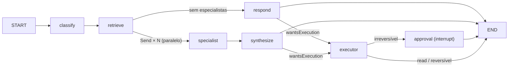

# Arquitetura — CARINA (versão TypeScript, fase 1)

Este documento descreve o que está construído em `apps/`, `packages/` e `docker-compose.yml`. A
visão geral, a demo e as garantias com os testes que as provam estão no [README](../README.md). O
desenho original e as razões das decisões estão no
[spec da migração](superpowers/specs/2026-11-11-migracao-typescript-design.md). A versão Python
antiga está em `legacy/python`.

## 1. Processos e implantação

| Processo | Entrada | O que roda |
| --- | --- | --- |
| `api` | `apps/api/src/main.ts` → `createApiApp()` | REST (`/api/*`), WebSocket do chat (`/ws/chat`, mesma porta), `InboxBroadcast`. Com `WORKERS_ENABLED !== "false"`, também os workers (útil em desenvolvimento, um processo só) |
| `worker` | `apps/api/src/main.worker.ts` → `createWorkerContext()` | `SyncWorker` (grupo `sync` em `jobs`), `ResumeWorker` (grupo `resumers` em `jobs`), `ReconciliationJob` (timer de 60 s com lock Redis). Força `WORKERS_ENABLED=true` e não abre porta |
| `migrate` | `prisma migrate deploy` (imagem `migrate`) | Migrações 0001–0006, escritas à mão, como `carina_migrator`. Roda uma vez |
| `seed` | `node dist/seed/seed.js` | Tenant `demo` (id fixo), duas chaves e três clientes sintéticos já sincronizados. Idempotente |
| `web` | nginx (`apps/web/nginx.conf`) | SPA do Vite, proxy de `/api` e `/ws` para `api:3000`, cabeçalhos de segurança e CSP |

O bootstrap fica num lugar só ([`bootstrap.ts`](../apps/api/src/bootstrap.ts)): `main.ts` e os
testes de boot ([`health.e2e.spec.ts`](../apps/api/test/health/health.e2e.spec.ts),
[`full-flow.e2e.spec.ts`](../apps/api/test/flow/full-flow.e2e.spec.ts)) usam a mesma
`configureHttpApp`: body parser de 5 MB, adaptador `ws`, prefixo `/api`, CORS restrito ao
`WEB_ORIGIN` e `ProblemDetailsFilter` global.

Uma falha de boot sai no stderr com a stack e a cadeia de `cause`
([`boot-error.ts`](../apps/api/src/core/errors/boot-error.ts)). O `Env` é validado com Zod na
subida. Com `NODE_ENV=production`, `LLM_MODE` é obrigatória.

**Réplicas.** Várias instâncias de `api` são seguras: os limites ficam no Redis, cada processo
HTTP tem o seu tail de `inbox.events` e os turnos de chat são serializados por thread com lock
Redis. Várias instâncias de `worker` também: consumer groups, dedup por `eventId`, lock por
cliente no Sync, lock por tick na reconciliação e execução única garantida no banco. A demo usa
uma de cada.

## 2. Monorepo e fronteiras

```
packages/shared   Zod + tipos: ChatRequest/ChatEvent/ChatResponse, ApprovalView, UsageSummary,
                  AuditEventView, NormalizedPosition/Transaction, StreamEvent, Problem, Money.
                  Sem dependência de Node; o web importa direto do fonte.
apps/api/src/core config (Env + models.yaml), context (TenantContext), database (PrismaService,
                  TenantPrismaService), redis (cache, streams, locks), logging (pino), errors
                  (DomainError → RFC 9457), http (body parser, adaptador ws)
apps/api/src/modules
  tenancy         hash de chaves, ApiKeyGuard, escopos, LiveKeyService, clientes
  limits          RateLimitGuard (janela deslizante) e QuotaService (cota mensal), em Lua
  llm             ModelFactory por papel, withFallbacks, limitador por provedor, embeddings, mock
  knowledge       ingestão de documentos (chunks, entidades, relações, embeddings) e busca híbrida
  agents          navigator, insight, predictor, risk, executor (prompt + schema + limites)
  orchestrator    grafo LangGraph, checkpointer Postgres, ResumeWorker
  inbox           risco, solicitações, decisão com trava, executores simulados, execução única,
                  reconciliação
  billing         preço por tipo de trabalho, fee sobre valor executado, resumo do mês
  watchtower      flags de compliance e trilha de auditoria append-only
  chat            POST /chat, ticket do WS, ChatGateway, InboxBroadcast
  data-ingestion  API de ingestão em lote, gerador sintético, SyncWorker
  health          /health e /ready (single-flight + cache curto)
```

As regras de fronteira são verificadas assim:

- Só `core/database` e `modules/tenancy` importam o `PrismaService` (sem RLS). É uma regra de
  ESLint, fixada por
  [`prisma-import-restriction.spec.ts`](../apps/api/src/core/database/prisma-import-restriction.spec.ts).
  O resto usa `TenantPrismaService`.
- Só `llm` fala com provedores de modelo. Só `agents` e `orchestrator` usam LangGraph.
- O SQL do conhecimento (pgvector, `WITH RECURSIVE`) é fixo e parametrizado, e fica num único
  `KnowledgeRepository`. **O LLM nunca gera SQL.**

## 3. Ciclo de vida de uma requisição

1. **`ApiKeyGuard`** (global). Aceita `Authorization: Bearer sk-live-…` ou `X-API-Key`. Confere o
   formato antes de ir ao banco e chama `resolve_api_key(sha256)`, uma função `SECURITY DEFINER`
   com `search_path = public, pg_temp`. Chave revogada ou tenant suspenso → 401. `@Public()` só em
   `/health` e `/ready`.
2. **Escopos.** Toda rota não pública declara `@RequireScopes` (todos) ou `@RequireAnyScope` (um
   deles): `chat`, `inbox:decide`, `data:write` e `admin`.
3. **`RateLimitGuard`.** Janela deslizante de 60 s por tenant (ZSET + Lua), com `Retry-After`.
   Falha fechado se o Redis cair.
4. **`TenantContext`** (AsyncLocalStorage). O `TenantPrismaService` abre uma transação por
   operação com `set_config('app.tenant_id', …, true)` e, quando há cliente fixado,
   `app.client_id`. O contexto é capturado **na chamada** do delegate, não no `await`.
5. **Erros.** `DomainError` → `application/problem+json` com `traceId`: 422 validação, 401, 403,
   404 (recurso de outro tenant, sem revelar que existe), 409 conflito, 429 e 503 com
   `Retry-After`. Mensagens internas não vão ao cliente.
6. **Logs.** nestjs-pino em JSON, com `tenantId` e `keyId` na linha da requisição. Mascara
   `authorization`, `x-api-key`, `cookie` e campos pessoais conhecidos, e não registra a query
   string.

## 4. Dados e Row-Level Security

Papéis: `carina_migrator` é o dono e roda as migrações e o seed. `carina_app` é o papel de
runtime: `NOSUPERUSER NOBYPASSRLS`, sem acesso a `api_key`.

| Tabelas | Política |
| --- | --- |
| `usage_record`, `audit_event` | `tenant_id = app.tenant_id`; `carina_app` só tem `SELECT, INSERT` (append-only) |
| `client`, `approval_request`, `executed_action`, `position`, `transaction`, `import_job` | tenant igual; se `app.client_id` estiver fixado, o cliente também |
| `kg_document`, `kg_chunk`, `kg_entity`, `kg_relation`, `kg_mention` | **tenant E cliente obrigatórios**: sem `app.client_id`, nenhuma linha |
| `tenant` | leitura só do próprio tenant |
| `api_key` | sem acesso para `carina_app`; só via `resolve_api_key` / `resolve_api_key_by_id` |
| schema `langgraph` | tabelas do checkpointer, sem RLS; o `thread_id` é `tenant:cliente:uuid` e só é retomado a partir de uma `approval_request` (sob RLS) ou do chat do mesmo cliente |

Todas as tabelas de dados usam `ENABLE` + `FORCE ROW LEVEL SECURITY`. Sem `app.tenant_id`,
`current_setting` devolve NULL e nada volta. Integridade entre tabelas:

- `executed_action` → `approval_request` usa FK composta `(tenant, cliente, id)`;
- `decided_by_key_id` só aceita chave do mesmo tenant (0003);
- `kg_relation` só liga entidades do mesmo cliente.

Dinheiro é `numeric(18,2)` e trafega como string decimal (`MoneySchema`). Quantidades usam
`numeric(24,8)`.

## 5. Conhecimento (pgvector)

- **Ingestão** (`KnowledgeService.ingestDocument`): chunks com embedding `vector(1024)` e `tsv`
  (português, coluna gerada); entidades com upsert por `(type, name)`; relações e menções. Tudo
  numa transação, com advisory lock por `(source, title)`. Reingerir o mesmo documento substitui
  os chunks.
- **Busca híbrida**: top-k vetorial (HNSW, cosseno) + top-k full-text, fundidos por RRF
  (`k = 60`), seguidos das entidades citadas nesses chunks e da vizinhança de até 2 saltos
  (`WITH RECURSIVE`, limitada). Cada trecho volta com `documentId` e `chunkId` para citação.
- Com pgvector ≥ 0.8, `SET LOCAL hnsw.iterative_scan = relaxed_order` evita que o filtro da RLS
  derrube o recall. Em versões antigas o `SET` falha dentro de um `SAVEPOINT` e a busca segue.
- **Sync** (`SyncWorker`, sem LLM): consome `data.ingested` e transforma posições e transações do
  cliente em documentos ("Carteira consolidada", "Fluxo de caixa 12 meses"), entidades (ativos,
  instituições, categorias) e relações. Um lock Redis por `(tenant, cliente)` serializa as
  sincronizações. Quem não pega o lock relança `SyncBusyError` e a entrega é repetida pelo
  reclaim.

## 6. Modelos (`llm`)

- `config/models.yaml` define, por papel (`conversational`, `reasoning`, `embeddings`), um
  `primary` e uma lista `fallback`. `ModelFactory.forRole(role, { schema? | tools? })` aplica
  `withStructuredOutput`/`bindTools` em **cada** modelo e só depois encadeia com
  `withFallbacks()`. O primário roda com `maxRetries: 0`, para que um 429 passe logo para o
  próximo modelo.
- Limitador por provedor no Redis (padrão 20 req/min para modelos `:free`). Ele **falha aberto**
  se o Redis cair: protege a cota do provedor, não é fronteira de segurança.
- A cadeia inteira falhando vira `AllProvidersFailedError` (503 com mensagem genérica). Em
  streaming, o fallback só acontece antes do primeiro pedaço.
- `LLM_MODE=mock`: modelos determinísticos com responders por agente; embeddings por hash
  (1024 dimensões, normalizados). Em mock, uma saída fora do schema vira `ValidationError` (bug
  do responder). Em live, vira `AllProvidersFailedError`.
- A saída de todo agente é tratada como **não confiável**: schema Zod e depois limites (tamanho
  de listas e textos, `checkMoney`, formato do `place_trade`).

## 7. Orquestrador (LangGraph.js)



- **`classify`** usa o papel `reasoning` com saída estruturada (`Plan`). A saída do modelo é
  revalidada (`normalizePlan`): ele pode desligar a execução, mas só liga `wantsExecution` se a
  própria pergunta tiver um verbo de execução. Se todos os modelos falharem, cai na heurística
  por palavras-chave do Python.
- **`retrieve`** faz a busca híbrida no conhecimento do cliente.
- **Especialistas** (insight, predictor, risk) rodam em paralelo via `Send`. A falha de um vira
  `{agent, error}` no estado, e a síntese menciona a análise que faltou.
- **`respond` / `synthesize`**: o Navigator produz a resposta final (em streaming de `token`).
- **`executor`** gera uma `ActionProposal` validada. `classifyRisk`: `READ` executa direto,
  `REVERSIBLE` executa, e **qualquer outra ação é `IRREVERSIBLE`**. Para uma ação irreversível o
  nó grava a `approval_request` com id determinístico (hash de thread, ação e payload), o que é
  idempotente. A chamada de modelo fica fora do nó que pausa.
- **`approval`** chama `interrupt({ approvalId })`. Na retomada, o valor do `resume` é só um
  sinal: o nó relê a aprovação no banco e só chama `executeOnce` se ela estiver `approved`.
- O estado por thread fica no `PostgresSaver`, no schema `langgraph`, criado pela migração 0005.
  O `carina_app` lê e grava checkpoints, mas não cria objetos nesse schema. O histórico é
  cortado: 20 mensagens no estado, 12 por chamada de agente.
- Um turno por thread de cada vez: um lock Redis por thread dá 409 `thread_busy`. Um thread que
  aguarda aprovação pendente dá 409. Uma espera já resolvida no banco (rejeitada ou vencida com o
  `resume` perdido) é curada no próximo turno.

## 8. Aprovação e execução única (`inbox`)

1. **Decisão** (`POST /api/inbox/:id/decision`, escopo `inbox:decide`). Numa transação:
   `SELECT … FOR UPDATE`, confere que está `pending` e não vencida (senão 409) e grava status,
   `decided_by_key_id`, `decided_at` e `reason`. **Depois do commit** publica `resume` em `jobs`.
2. **`ResumeWorker`**: fixa o `TenantContext` a partir do evento, valida o thread
   (`tenant:cliente:uuid`) contra o evento e retoma o grafo. `NotFound` é terminal (ACK); um
   conflito transitório é repetido pela reentrega.
3. **`executeOnce`**: `INSERT executed_action(status='started')`. Se houver conflito, outro
   worker já executou e este para. Depois chama o executor registrado e, numa **mesma
   transação**, grava `succeeded`, `usage_record(execution)` e `audit_event`. Se a cobrança ou a
   auditoria falharem, tudo reverte e a linha vira `needs_review`. A garantia é **no máximo uma
   vez**: efeitos externos não cabem numa transação do banco.
4. **`ReconciliationJob`** (a cada 60 s, lock por tick):
   - vence as solicitações pendentes expiradas e retoma o grafo como rejeitado;
   - republica `resume` para aprovações `approved` sem `executed_action` há mais de 2 min;
   - marca `started` há mais de 5 min como `needs_review`, que **nunca é reexecutado**.

   Os tenants vêm de `active_tenant_ids()` (`SECURITY DEFINER`) e cada um é processado sob RLS
   como `carina_app`.
5. **Notificação**: `approval.executed` vai para `inbox.events`. O `InboxBroadcast` de cada
   processo HTTP faz tail do stream e repassa o evento só aos sockets do mesmo tenant e cliente.

**Cobrança** ([`pricing.ts`](../apps/api/src/modules/billing/pricing.ts)):

- o tipo de trabalho do chat vem dos agentes do plano: nenhum → `query` R$ 1,50; um →
  `analysis` R$ 7,50; dois ou mais → `multi_agent_analysis` R$ 15,00;
- `execution` custa R$ 75,00 + `round_half_up(valor × EXECUTION_FEE_PCT / 100, 2)`, com taxa
  padrão de 0,5%;
- cada lote de ingestão é um `data_ingestion` de R$ 0,05.

## 9. Redis Streams

| Stream | Produtores | Consumidores |
| --- | --- | --- |
| `jobs` | decisão e reconciliação (`resume`), ingestão (`data.ingested`) | grupos `resumers` (ResumeWorker) e `sync` (SyncWorker) |
| `inbox.events` | inbox (`approval.created`, `approval.executed`) | `InboxBroadcast` (tail, sem grupo) |
| `notifications` | — (contrato pronto para a fase 3) | — |

- O consumo usa `XREADGROUP BLOCK 5000`, com `XACK` só depois do sucesso.
- O reclaim pega mensagens paradas há 60 s (`XAUTOCLAIM`). Depois de 5 entregas, a mensagem vai
  para `<stream>.dlq` com o erro: primeiro o `XADD` na DLQ, depois o `XACK`.
- Dedup: `SET dedup:<stream>:<eventId> NX EX 86400`.
- Os eventos são validados com Zod (`StreamEvent`) ao publicar e ao consumir. Uma entrada
  inválida vai direto para a DLQ.
- O tail resolve o id inicial uma vez (`XREVRANGE`) e avança o cursor. Assim não perde evento
  entre dois `BLOCK`s.

## 10. WebSocket do chat

1. `POST /api/ws/ticket` (escopo `chat`, corpo `{ clientId }`) devolve um ticket de 30 s, preso
   ao tenant, à chave e ao cliente.
2. `GET /ws/chat?ticket=…` com upgrade. O ticket é consumido com `GETDEL` (uso único). Se for
   inválido, vencido ou reutilizado, o servidor fecha com 4401.
3. Cada mensagem é um `ChatRequest` estrito (o mesmo schema do REST). Antes de cada turno o
   servidor revalida chave, escopo e tenant por id (`LiveKeyService`, cache de até
   `API_KEY_REVALIDATE_TTL_MS`) e aplica rpm e cota vigentes.
4. Eventos: `plan`, `agent_started`, `token`, `agent_result`, `approval_required`,
   `approval_executed`, `done` (com `usage` e `compliance`) e `error` (`code` + `traceId`).
5. Códigos de fechamento: 4401 (não autorizado ou vida máxima `WS_MAX_CONNECTION_MS`
   vencida), 4408 (ocioso, 10 min), 1009 (mensagem grande demais) e 1001 (desligamento). Há
   heartbeat por ping.
6. Se o cliente desconectar no meio de um turno, o turno termina em segundo plano, para a
   aprovação não ficar órfã, e o lock é liberado.

## 11. Configuração

Todas as variáveis estão documentadas em [`.env.example`](../.env.example) e validadas por
[`env.ts`](../apps/api/src/core/config/env.ts). As principais:

- `DATABASE_URL` (`carina_app`), `MIGRATION_DATABASE_URL` (só migrações e seed) e `REDIS_URL`;
- `LLM_MODE` e as chaves dos provedores;
- `WORKERS_ENABLED`, `WEB_ORIGIN`, `EXECUTION_FEE_PCT`, `DEFAULT_RPM` e `APPROVAL_TTL_HOURS`;
- `WS_MAX_CONNECTION_MS` e `API_KEY_REVALIDATE_TTL_MS`.

## 12. Testes

| Projeto | Onde | Infra |
| --- | --- | --- |
| `unit` | `apps/api/src/**/*.spec.ts`, `packages/shared`, `apps/web` (jsdom + MSW) | nenhuma |
| `int` | `apps/api/test/**/*.int.spec.ts` | Postgres + pgvector e Redis reais; um banco por execução |
| `e2e` | `apps/api/test/**/*.e2e.spec.ts` | idem, com app Nest real (Supertest + `ws`) e `LLM_MODE=mock` |

- Os projetos rodam em sequência (`sequence.groupOrder`).
- Cada arquivo tem um DB lógico do Redis próprio
  ([`redis-dbs.ts`](../apps/api/test/setup/redis-dbs.ts)).
- A cobertura (`test:cov`) mede `src/modules/**` com limite de 80% de linhas.
- O CI roda tudo com PG17 (`en_US.utf8`). Localmente, `TEST_DB_ICU_LOCALE=en-US` reproduz a
  ordenação de texto do CI.
